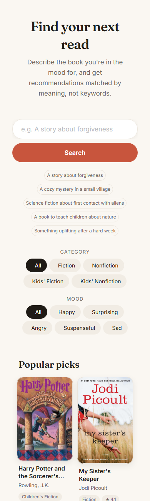
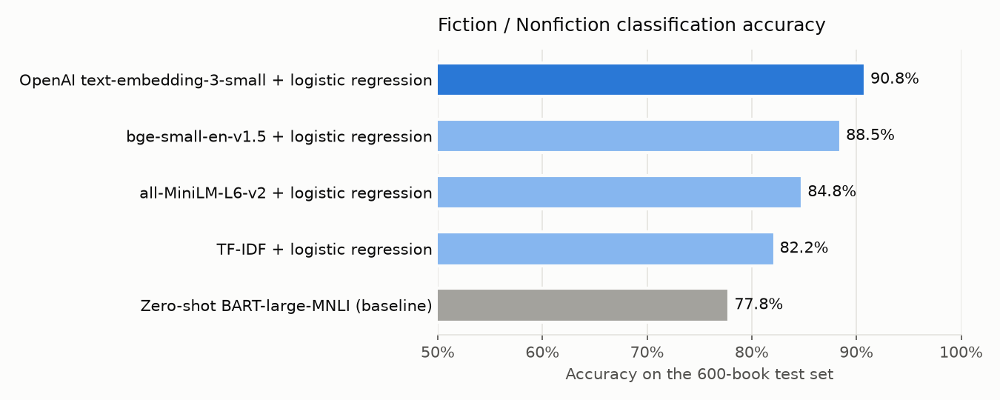
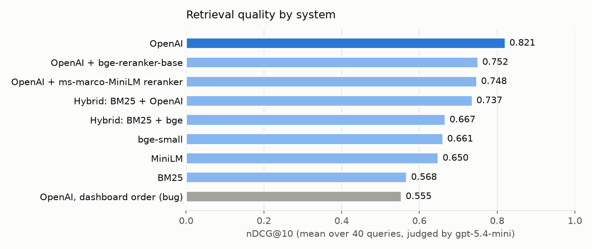

# Semantic Book Recommender

[](https://huggingface.co/spaces/nancyvora/Book-Recommender)
[](https://huggingface.co/spaces/nancyvora/Book-Recommender)

**[Try the live demo on Hugging Face Spaces →](https://huggingface.co/spaces/nancyvora/Book-Recommender)**

A book recommender that finds books from a plain-language description of what you want to read, such as *"a story about forgiveness"* or *"a book to teach children about nature"*. You can filter the results by category and sort them by emotional tone (happy, surprising, angry, suspenseful or sad).

It combines three techniques:

- **Vector search**: book descriptions are embedded with OpenAI's `text-embedding-3-small` and stored in a Chroma vector database. Your query is matched against them by semantic similarity.
- **Text classification**: books with missing or messy categories are labelled *Fiction* or *Nonfiction* by a logistic-regression classifier trained on the books' embeddings. It reaches **90.8% accuracy**, up from 77.8% with zero-shot `facebook/bart-large-mnli`.
- **Emotion analysis**: each description is scored for anger, disgust, fear, joy, sadness, surprise and neutral with `j-hartmann/emotion-english-distilroberta-base`.

The results are shown in a Gradio web app with a Pinterest-style wall of book covers.

## Screenshots

**Search results** for *"A story about forgiveness"*, shown as a masonry wall of covers. Hovering a cover reveals its description:


**On a phone**, the search bar and filters stack and the wall switches to two columns:



## Dataset

[7k Books with Metadata](https://www.kaggle.com/datasets/dylanjcastillo/7k-books-with-metadata) from Kaggle, downloaded with `kagglehub`. After cleaning, **5,197 books** remain:

| Category | Books |
|---|---|
| Fiction | 2,989 |
| Nonfiction | 1,761 |
| Children's Fiction | 390 |
| Children's Nonfiction | 57 |

## Project structure

```
Book-Recommender/
├── recommender.py                   # Data loading and semantic search (shared by everything below)
├── app.py                           # Gradio web app
├── api.py                           # FastAPI service: JSON API, with the web app mounted at /
├── tests/                           # pytest suite (runs offline, no API key needed)
├── Dockerfile                       # Container for the API + web app
├── deploy/deploy_space.py           # Uploads the app to a Hugging Face Space
├── cover-not-found.jpg              # Placeholder for books without a cover
├── requirements.txt                 # Everything, including the notebooks
├── requirements-app.txt             # Pinned runtime dependencies for the app only
├── .env                             # API keys (git-ignored)
├── .gitignore
├── screenshots/                     # Screenshots and charts used in this README
├── notebooks/
│   ├── data-exploration.ipynb       # 1. Download, clean and filter the data
│   ├── text-classification.ipynb    # 2. Simplify categories, fill gaps with zero-shot
│   ├── sentiment-analysis.ipynb     # 3. Score each description for emotions
│   ├── vector-search.ipynb          # 4. Build the Chroma vector database
│   ├── classifier-improvement.ipynb # 5. Replace zero-shot with a trained classifier
│   └── retrieval-evaluation.ipynb   # 6. Measure and compare search quality
└── data/
    ├── processed/
    │   ├── books_cleaned.csv
    │   ├── books_cleaned_with_categories.csv
    │   ├── books_with_emotions.csv  # Final dataset used by the app
    │   ├── tagged_description.txt   # "<isbn13> <description>" per line, for embedding
    │   └── zero_shot_test_predictions.csv  # Cached baseline predictions (slow to recompute)
    ├── evaluation/
    │   ├── queries.csv              # 40 test queries
    │   ├── llm_judgments.csv        # LLM relevance grades (cached)
    │   └── human_check.csv          # 50 hand-graded judgments to validate the LLM judge
    └── chroma_db/                   # Persisted vector database
```

## How it works

### 1. Data exploration and cleaning (`data-exploration.ipynb`)
- Looks at missing values and how they relate to page count, rating and book age.
- Drops books that are missing a description, page count, rating, rating count or publication year.
- Keeps only descriptions of **25 words or more**, because shorter ones carry too little meaning to embed.
- Builds `title_and_subtitle` and `tagged_description` (the ISBN-13 followed by the description). The tag lets each search result be traced back to its book.

### 2. Text classification (`text-classification.ipynb`)
- Maps the many original Google Books categories onto four simple ones: Fiction, Nonfiction, Children's Fiction and Children's Nonfiction.
- Tests zero-shot classification with `facebook/bart-large-mnli` on 600 books whose labels are known (300 Fiction, 300 Nonfiction). It got **~78% accuracy**.
- Uses the model to label the books that had no mapped category. Step 5 later replaces these labels with better ones.

### 3. Sentiment analysis (`sentiment-analysis.ipynb`)
- Splits each description into sentences and runs the emotion classifier on every sentence.
- For each of the 7 emotions, stores the **highest score among the sentences** as that book's score.

### 4. Vector search (`vector-search.ipynb`)
- Writes the tagged descriptions to `tagged_description.txt`, one book per line.
- Embeds each line with `text-embedding-3-small` and saves the vectors to `data/chroma_db`. It works in batches of 300 with a pause between them to stay within API rate limits.

### 5. Improving the classifier (`classifier-improvement.ipynb`)
The zero-shot model never sees a labelled example, even though 3,743 books already have a known category. This step trains a classifier on those books and compares it fairly with zero-shot:
- **Same test set:** the identical 600 books zero-shot was scored on, held out from all training and model selection.
- **Four feature sets:** TF-IDF, `all-MiniLM-L6-v2`, `bge-small-en-v1.5`, and the OpenAI embeddings already stored in Chroma, so no new API calls are needed.
- **Model selection:** 16 configurations (features × class weighting × extra children's training data), chosen by 5-fold cross-validation on the training set only. The test set is scored once.



| Model | Test accuracy |
|---|---|
| Zero-shot BART-large-MNLI (baseline) | 77.8% |
| TF-IDF + logistic regression | 82.2% |
| all-MiniLM-L6-v2 + logistic regression | 84.8% |
| bge-small-en-v1.5 + logistic regression | 88.5% |
| **OpenAI embeddings + logistic regression** | **90.8%** |

- **+13.0 points** over zero-shot (95% bootstrap CI +9.3 to +16.7, McNemar's exact test p = 7e-12).
- Zero-shot mislabelled 96 of 300 Fiction books as Nonfiction. The new model's errors are balanced (23 and 32).
- Re-labelling the 1,454 uncategorised books changed **307 labels**, and the dashboard's category filter uses the new labels.

### 6. Retrieval evaluation (`retrieval-evaluation.ipynb`)
Similar isn't the same as *good*, so this step measures whether the recommendations are actually relevant:
- **40 test queries** written the way a user would type them: fiction, nonfiction, children's and mood-based.
- **9 rankings compared:** OpenAI embeddings, two open-source embedding models, BM25 keyword search, two hybrids (reciprocal rank fusion) and two cross-encoder re-rankers, plus the dashboard's original ordering.
- **Pooled LLM judging:** every book in any system's top 10 (1,662 query–book pairs) is graded 0/1/2 by `gpt-5.4-mini`, which never sees which system found the book.
- **Judge validated by hand:** 50 judgments graded blind by a human give **quadratic-weighted Cohen's κ = 0.69** (substantial agreement), with 96% of grades within one point.



| System | nDCG@10 | MRR | Latency per search |
|---|---|---|---|
| **OpenAI embeddings (used by the app)** | **0.821** | **0.767** | ~200–400 ms (API call) |
| OpenAI + cross-encoder re-ranker (best of two) | 0.752 | 0.589 | + 1.5–12 s on CPU |
| Hybrid: BM25 + OpenAI | 0.737 | 0.654 | ~200–400 ms |
| bge-small-en-v1.5 (best open-source) | 0.661 | 0.606 | ~22 ms |
| BM25 keyword search | 0.568 | 0.458 | ~6 ms |
| *Dashboard before the ranking fix* | *0.555* | *0.379* | |

**What it found**
- **A ranking bug.** The dashboard retrieved the right books but showed them in CSV file order, not relevance order. Fixing it raised nDCG from **0.555 to 0.821** (+48%).
- **OpenAI embeddings are the best choice.** Every alternative scored significantly lower (paired bootstrap, 95% CI).
- **Re-ranking and hybrid search made results worse.** The cross-encoders are trained on web question-answering, not on matching a book's theme or tone. BM25 rewards shared common words like "story" and "life".
- **Searching costs almost nothing.** A query embeds about 10 tokens, so OpenAI's per-search cost is negligible even though it's the most accurate option.

### 7. Web app and API (`app.py`, `api.py`, `recommender.py`)
For each query, the search in `recommender.py`:
1. Gets the 50 most similar books from Chroma, in relevance order.
2. Filters them by the category you picked. If too few books match, it searches deeper, so small categories like Children's Nonfiction still return a full page.
3. Keeps the top results: 24 in the web app, 16 by default in the API.
4. Sorts them by the emotion you picked. **Happy** sorts by joy, **Surprising** by surprise, **Angry** by anger, **Suspenseful** by fear and **Sad** by sadness.
5. Shows them as a masonry wall of cover cards with the title, authors, category and rating. Hovering a cover reveals its description.

Before the first search, the page shows a wall of popular, well-rated books, which needs no API call. Category and mood are tappable chips that refresh the results immediately, and there are suggested searches to try. The layout supports dark mode and phone-sized screens.

## Setup

**Requirements:** Python 3.11+ (developed on 3.13; the deployed app runs on 3.12) and an OpenAI API key. The vector database already exists in `data/chroma_db`, but the app still calls OpenAI to embed each search query.

```bash
# 1. Create and activate a virtual environment
python -m venv venv
venv\Scripts\activate          # Windows
# source venv/bin/activate     # macOS / Linux

# 2. Install dependencies
pip install -r requirements.txt
```

Create a `.env` file in the project root:

```
OPENAI_API_KEY=your-openai-key
HUGGINGFACEHUB_API_TOKEN=your-huggingface-token
```

The Hugging Face token is only needed if you re-run the classification and sentiment notebooks.

## Usage

### Run the web app

```bash
python app.py
```

Then open http://127.0.0.1:7860. Describe the book you want, optionally pick a category and mood, and click **Search**.

### Run the API

```bash
uvicorn api:app --port 7860
```

This serves the same web app at http://127.0.0.1:7860, plus a JSON API with interactive docs at http://127.0.0.1:7860/docs:

```bash
curl -X POST http://127.0.0.1:7860/recommend \
  -H "Content-Type: application/json" \
  -d '{"query": "A cozy mystery in a small village", "category": "Fiction", "top_k": 3}'
```

| Endpoint | Description |
|---|---|
| `POST /recommend` | `query` (required), `category` (`All`, `Fiction`, `Nonfiction`, `Children's Fiction`, `Children's Nonfiction`), `tone` (`All`, `Happy`, `Surprising`, `Angry`, `Suspenseful`, `Sad`), `top_k` (1–50, default 16). Invalid input returns `422`; a search outage returns `503`. |
| `GET /health` | Returns `{"status": "ok", "books": 5197}`. |

### Run the tests

```bash
pytest
```

There are 16 tests covering search ranking, the category filter, mood sorting, the API's validation and error handling, and HTML escaping in the web app. They replace OpenAI query embeddings with vectors already stored in Chroma, so they **run offline in a few seconds and need no API key**. Two of them are regression tests for the ranking bug, and they fail if it's reintroduced.

### Run with Docker

```bash
docker build -t book-recommender .
docker run -p 7860:7860 --env-file .env book-recommender
```

The OpenAI key is passed in when the container starts, never built into the image.

### Deploy to Hugging Face Spaces

Free personal accounts can host Gradio apps on ZeroGPU hardware. The app needs no GPU, but this is the free tier.

```bash
hf auth login                                         # once
python deploy/deploy_space.py <your-username>/<space-name>
```

Then, in the Space's **Settings**, add `OPENAI_API_KEY` as a **secret** and choose **ZeroGPU** hardware.

### Rebuild the data from scratch

Run the notebooks in this order:

1. `data-exploration.ipynb`
2. `text-classification.ipynb` (a GPU helps; it uses `device=0`)
3. `sentiment-analysis.ipynb`
4. `vector-search.ipynb` (this calls the OpenAI embeddings API)
5. `classifier-improvement.ipynb` (reads the embeddings from step 4 and updates the category labels; about 7 minutes on CPU with the cached baseline, about 30 without)
6. `retrieval-evaluation.ipynb` (about 10 minutes on CPU with cached judgments; judging from scratch costs under $1 in OpenAI API calls)

## Notes

- **Paths.** All paths are relative. The app resolves them from its own location, so you can run it from any folder. The notebooks use `../data/...`, so start Jupyter from the project root or from `notebooks/`.
- **Keep your keys private.** `.env` is listed in `.gitignore`, so git won't commit it.

## Tech stack

Python · pandas · NumPy · LangChain · OpenAI Embeddings · ChromaDB · Hugging Face Transformers · sentence-transformers · scikit-learn · rank_bm25 · PyTorch · Gradio · FastAPI · pytest · Docker · Hugging Face Spaces · Matplotlib / Seaborn
